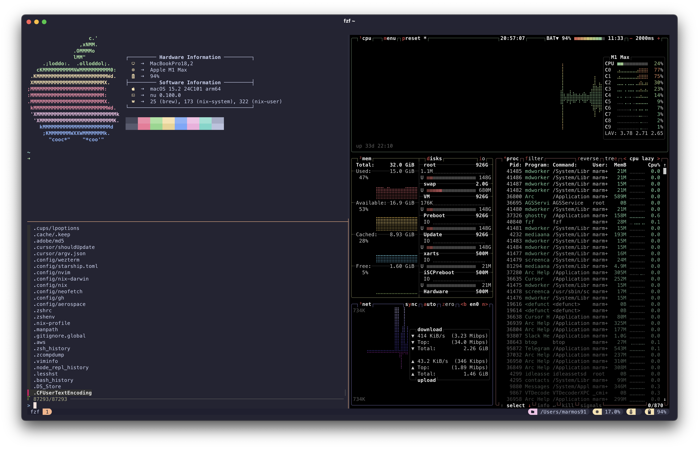

# marmos91 dotfiles

Cross-platform dotfiles for **macOS** and **Linux** (Ubuntu/GNOME), powered by Nix, Home Manager, and Stow.



## Highlights

- **Cross-platform**: Works on macOS (Apple Silicon only: the flake builds `aarch64-darwin`) and Linux (x86_64 & aarch64)
- **Declarative configuration**: Managed with [Nix Darwin](https://github.com/LnL7/nix-darwin) (macOS) and [Home Manager](https://github.com/nix-community/home-manager) (Linux)
- **Consistent theming**: [Catppuccin Mocha](https://github.com/catppuccin/catppuccin) across all tools via [catppuccin/nix](https://github.com/catppuccin/nix)
- **Terminal emulators**: [Ghostty](https://github.com/ghostty-org/ghostty)
- **Shell**: Zsh with [Starship](https://starship.rs/) prompt
- **Editor**: [Neovim](https://neovim.io/) with custom Lua configuration
- **Terminal multiplexer**: [Tmux](https://github.com/tmux/tmux/wiki) with catppuccin theme
- **Calendar sync**: hourly Family → work-calendar mirror ([gcal-personal-block](.local/bin/gcal-personal-block)) as opaque busy blocks; identifiers live in sops

## Installation

Clone the repository:

```bash
git clone https://github.com/marmos91/dotfiles.git ~/.dotfiles
cd ~/.dotfiles
```

Run the install script:

```bash
chmod +x install.sh && ./install.sh
```

### Options

| Flag | Description |
|------|-------------|
| `--shell <shell>` | Set default shell (`zsh` or `bash`), Linux only. Default: `zsh`. Ignored on macOS, which keeps its own `/bin/zsh` as the login shell |
| `--shell-only` | Only change the default shell, skip full installation |
| `--no-stow` | Skip stowing dotfiles |
| `--skip-nix` | Skip Nix installation (use existing Nix) |
| `--no-1password` | Skip 1Password installation (Linux only) |
| `--no-docker` | Skip Docker installation (Linux only) |
| `--help` | Show help message |

**Examples:**

```bash
./install.sh                          # Full install with defaults
./install.sh --shell bash             # Install with bash as default shell (Linux)
./install.sh --shell-only             # Only set zsh as default (skip install)
./install.sh --no-stow --skip-nix     # Only apply Nix configuration
./install.sh --no-1password           # Skip 1Password installation on Linux
./install.sh --no-docker              # Skip Docker installation on Linux
```

### What it does

1. Install [Stow](https://www.gnu.org/software/stow/) (via Homebrew on macOS, apt/dnf/pacman/zypper on Linux)
2. Symlink dotfiles to your home directory via Stow — only `.config` (home-manager owns `~/.gnupg`);
   everything else is left alone. On a machine provisioned by an older version,
   links it created into the repo are cleaned up first: a folded `~/.claude` or
   `~/.local` is copied out into a real directory (it holds your own state), links
   inside them are replaced by copies, and the `~/CLAUDE.md`, `~/.pi` and
   `~/.gitignore.global` links are removed. The repo's `.claude/settings.json` is
   the project settings for this checkout, so it is not linked into `~/.claude`
3. Install [Nix](https://nixos.org/) using the [Determinate Systems installer](https://determinate.systems/nix-installer/)
4. Install [1Password](https://1password.com/) via official apt repository (Linux only, for SSH agent)
5. Install Docker Engine (Linux only, Debian/Ubuntu, unless `--no-docker`): adds
   Docker's apt repository and key with `sudo`, installs `docker-ce` and its
   plugins, enables the root `docker` service, and adds you to the `docker`
   group, which is root-equivalent. Log out and back in for the group to apply
6. Create the sops age key if it is missing — the Nix step refuses to activate
   without it. The script stops and prints the command rather than creating a
   key it cannot back up; see
   [`.config/nix-darwin/home/secrets/README.md`](./.config/nix-darwin/home/secrets/README.md)
   §1
7. Apply the appropriate Nix configuration:
   - **macOS**: nix-darwin + home-manager
   - **Linux**: standalone home-manager
8. Set the default shell (Linux only)

### SSH keys and commit signing

1Password stores the keys; how they're used differs per platform.

**macOS** — keys live on disk and 1Password is only the backup, so nothing
prompts for a fingerprint on every commit or `ssh`. On a new machine:

1. **Open 1Password**, sign in, and enable **Settings → Developer → "Integrate
   with 1Password CLI"** (the SSH agent itself is not needed here)
2. **Restore the keys** into `~/.ssh`:

   ```bash
   op-ssh-restore --dry-run   # preview
   op-ssh-restore             # write; skips keys already present
   ```

   Pass `--force` to replace existing files (the old one is kept as `.bak`), and
   bare key names to limit the run: `op-ssh-restore --force id_ed25519`. Set
   `OP_SSH_VAULT` if the keys aren't in `Private`.

Git signs with `ssh-keygen` reading `~/.ssh/id_ed25519` directly — no agent is
involved. `user.signingkey` must therefore be a **path**; a literal public key
makes git use `ssh-keygen -Y sign -U`, which requires an agent and fails with
`Couldn't find key in agent?`.

Keys come out of 1Password without a passphrase, so anyone who can read
`~/.ssh` can use them. That is the trade for never being prompted.

**Linux** — the 1Password SSH agent is used directly: `SSH_AUTH_SOCK` points at
`~/.1password/agent.sock` (see `home/env.nix`), so enable **Settings → Developer
→ "Use the SSH agent"** there.

To verify:

```bash
git commit --allow-empty -m "Test signed commit"
git log --show-signature -1
```

**Note**: On macOS, `rebuild` installs the `1password` and `1password-cli` Homebrew
casks (`system/homebrew.nix`). Do not install 1Password separately from the Mac App
Store or a download: Homebrew does not manage that copy and it clashes with the cask.

### Post-install

Restart your terminal or log out/in for all changes to take effect.

If you previously stowed an older revision of these dotfiles, `~/.config` (or
one of its subdirectories) may already be a stow fold — a single symlink into
the repo. `.stowrc` now stows only `.config` and ignores `hosts.yml`, but stow
never splits an existing fold, so gh would keep writing its OAuth token into
the repo. Check the parent directory, not `~/.config/gh`: through a fold that
path resolves into the repo and always looks like a real directory.

```bash
ls -ld ~/.config         # a symlink means it is still folded
rm ~/.config             # delete the LINK, not a path inside it
mkdir ~/.config && stow .
```

If `~/.config` is a real directory, check the ones below it the same way
(`ls -ld ~/.config/gh`) and remove that link instead. Delete the link itself:
removing a file through a fold deletes the repo copy and gh keeps writing
through it. gh re-creates `hosts.yml` as a real file on the next
`gh auth login`.

## Uninstallation

To completely remove the dotfiles and Nix:

```bash
chmod +x uninstall.sh && ./uninstall.sh
```

### Options

| Flag | Description |
|------|-------------|
| `--dotfiles-only` | Only unstow dotfiles, keep Nix and packages |
| `--keep-nix` | Keep Nix installed, remove dotfiles and config |
| `--keep-stow` | Keep stow installed |
| `--keep-1password` | Keep 1Password installed (Linux only) |
| `--keep-docker` | Keep Docker installed (Linux only) |
| `--purge-data` | Also delete Docker data (`/var/lib/docker`, `/var/lib/containerd`, incl. volumes) and, on the manual fallback path, the Nix store `/nix`. Off by default |
| `-y, --yes` | Skip confirmation prompt |
| `--help` | Show help message |

**Examples:**

```bash
./uninstall.sh                    # Full uninstall (interactive)
./uninstall.sh -y                 # Full uninstall (no confirmation)
./uninstall.sh --dotfiles-only    # Only remove dotfile symlinks
./uninstall.sh --keep-nix         # Remove dotfiles but keep Nix
./uninstall.sh --keep-1password   # Keep 1Password installed on Linux
```

### What it removes

1. Dotfile symlinks (unstow)
2. Stow (unless `--keep-stow`)
3. 1Password app and CLI (Linux, unless `--keep-1password`)
4. Docker Engine (Linux, unless `--keep-docker`)
5. Home-manager configuration (Linux) — on macOS the nix-darwin configuration is left installed; the script prints `sudo darwin-uninstaller`, which must run before Nix can be removed
6. Nix and all packages (unless `--keep-nix`)
7. Nix cache files
8. Docker data and the Nix store only with `--purge-data` (the Determinate uninstaller always removes `/nix`)

**Warning**: Full uninstall is destructive and will remove all Nix-installed packages.
On Linux it also removes Docker Engine and the `docker` group unless `--keep-docker`;
images, containers and volumes under `/var/lib/docker` and `/var/lib/containerd` are
deleted only with `--purge-data`, and that cannot be undone.

## Usage

After installation, use the `rebuild` command to apply configuration changes:

```bash
rebuild
```

This automatically detects your platform and runs the appropriate command:
- **macOS**: `sudo darwin-rebuild switch --flake ~/.config/nix-darwin#amaterasu`
- **Linux (x86_64)**: `home-manager switch --flake ~/.config/nix-darwin#marmos91`
- **Linux (aarch64)**: `home-manager switch --flake ~/.config/nix-darwin#marmos91-aarch64`

Run these directly if `rebuild` is not defined yet, e.g. in a shell started before the first activation.

## Structure

```
~/.dotfiles/
├── .config/
│   ├── nix-darwin/          # Nix configuration
│   │   ├── flake.nix        # Main flake (inputs & outputs)
│   │   ├── system/          # macOS system config (nix-darwin)
│   │   └── home/            # User config (home-manager)
│   │       ├── catppuccin.nix      # Global theme config
│   │       ├── programs/
│   │       │   ├── desktop/        # GNOME settings (Linux)
│   │       │   ├── terminal/       # ghostty, tmux, starship
│   │       │   ├── shell/          # zsh
│   │       │   ├── git/            # git (incl. delta), lazygit
│   │       │   └── utilities/      # bat, fzf, btop, k9s, etc.
│   │       └── development/        # Language toolchains
│   └── nvim/                # Neovim configuration
├── install.sh               # Installation script
├── uninstall.sh             # Uninstallation script
└── README.md
```

## Platform-specific features

### macOS
- Homebrew casks for GUI applications
- System preferences (Dock, Finder, keyboard)
- AeroSpace window manager

### Linux (Ubuntu/GNOME)
- GNOME settings via dconf (keyboard repeat, trackpad, dark mode)
- Dash-to-Dock extension with auto-hide
- GNOME Terminal with Catppuccin theme
- Window buttons on left (macOS-style)

## Customization

Key files to customize:

| Purpose | File |
|---------|------|
| Theme (flavor/accent) | `home/catppuccin.nix` |
| Shell aliases | `home/programs/shell/common.nix` (both shells); zsh-only ones in `home/programs/shell/zsh.nix` |
| Git config | `home/programs/git/config.nix` |
| Neovim plugins | `.config/nvim/lua/plugins/` |
| Terminal settings | `home/programs/terminal/` |
| GNOME settings | `home/programs/desktop/gnome.nix` |
| Secrets management | `home/secrets/` ([README](.config/nix-darwin/home/secrets/README.md)) |

## License

[MIT LICENSE](./LICENSE)

## Tests

`tests/installation-scripts.sh` is an assert-based check of `install.sh`,
`uninstall.sh` and `.stowrc`. It runs each script against a throwaway `$HOME`
and shims, so it never touches the host:

```bash
bash tests/installation-scripts.sh
```
